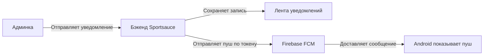
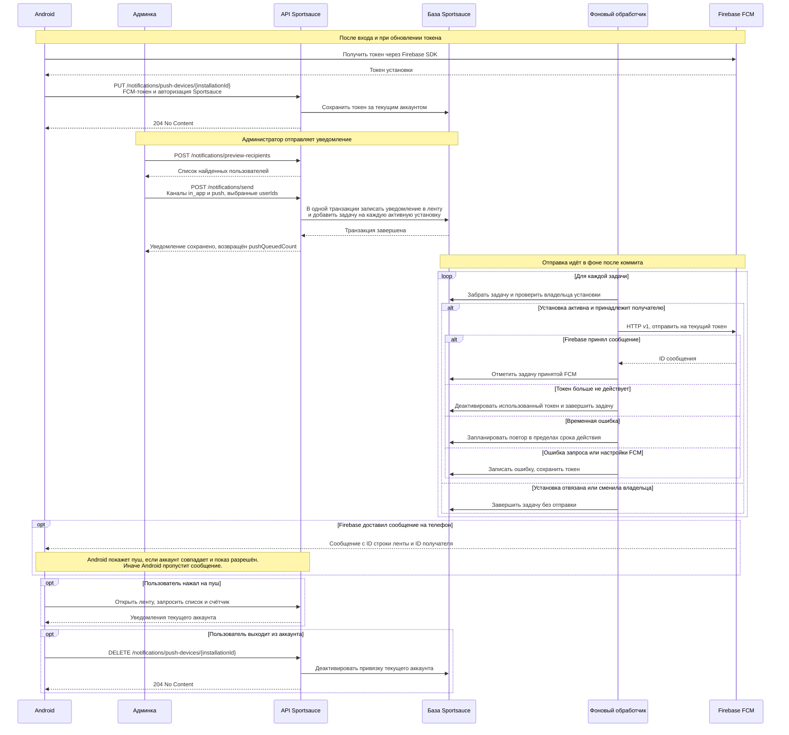

# Android-пуши Sportsauce через FCM

Сейчас администратор отправляет уведомление через `POST /notifications/send`, и пользователь видит его в ленте Sportsauce. Добавляем канал `push`, чтобы то же уведомление появлялось в шторке Android. Если у пользователя два телефона, в ленте будет одна запись, а пуш придёт на оба телефона.

FCM (Firebase Cloud Messaging) доставляет сообщение до телефона. Android получает у Firebase токен своей установки и передаёт его в Sportsauce после входа. Бэкенд хранит связь токена с аккаунтом и при отправке передаёт Firebase токен и текст пуша. Ленту и статус прочтения по-прежнему хранит Sportsauce.

## Общая схема



## Как проходит отправка

Диаграмма показывает первую привязку, ручную отправку и выход из аккаунта. Фоновый обработчик может работать в том же бэкенде. Его задача — отправлять пуши после сохранения записи в ленте.



Если токенов нет, сервер просто сохраняет запись в ленте. Если Firebase вернул ID сообщения, он принял запрос на отправку. Увидел ли пользователь пуш, из этого ответа узнать нельзя. [Отправка через FCM](https://firebase.google.com/docs/cloud-messaging/send/v1-api)

## 1. Привязка телефона к аккаунту

Оба метода принимают обычный `Authorization: Bearer <accessToken>` Sportsauce. Бэкенд берёт `userId` из сессии. `installationId` — UUID, который Android генерирует один раз на установку и хранит локально. FCM-токен может смениться, а UUID при этом остаётся прежним.

### `PUT /notifications/push-devices/{installationId}`

Тело запроса содержит токен, полученный от Firebase.

```json
{
  "fcmToken": "<registration-token-from-firebase>"
}
```

Создайте или обновите запись установки, сбросьте `disabledAt` и верните `204 No Content`. Повторный запрос обновляет `lastSeenAt`. Новый токен заменяет прежний. Если на том же телефоне вошли в другой аккаунт, смените владельца установки в той же транзакции.

Хватит таблицы с полями `installationId`, `userId`, `fcmToken`, `lastSeenAt` и `disabledAt`. Добавьте индекс для поиска активных устройств по `userId`. В каждом окружении один токен может быть активен только у одной установки. Если он пришёл с другим UUID, отключите прежнюю привязку в той же транзакции. Если dev и prod делят БД, включите окружение в ключи и запросы.

Возвращайте `401` при невалидной сессии и `400` при ошибке в UUID или пустом либо слишком длинном токене. Храните токен целиком. Уберите его из ответов API, логов и истории админки. [Рекомендации Firebase по токенам](https://firebase.google.com/docs/cloud-messaging/manage-tokens)

### `DELETE /notifications/push-devices/{installationId}`

Отключите привязку, если она принадлежит аккаунту из текущей сессии. Верните `204 No Content` и при повторном вызове, и если установка уже принадлежит другому аккаунту. Android попробует вызвать метод перед выходом из аккаунта или когда обнаружит, что пуши выключены. При выходе без сети проверка аккаунта на телефоне всё равно должна пропустить пуш старой сессии.

## 2. Что поменять в отправке из админки

В примере из админки `POST /notifications/preview-recipients` уже проверяет список получателей. Оставьте его как есть. В `POST /notifications/send` добавьте канал `push`. В первой версии он работает вместе с `in_app`. На запрос с одним `push` верните `400` с сообщением «Для отправки пуша выберите также уведомление в приложении».

```json
{
  "title": "Изменилось расписание старта",
  "text": "Проверьте обновлённое время в карточке старта.",
  "recipientType": "user_ids",
  "channels": ["in_app", "push"],
  "userIds": [42]
}
```

Права администратора и выбор получателей проверяйте тем же кодом, что и сейчас. Сохраните одну запись уведомления и по одной строке ленты на каждого получателя. В ту же транзакцию добавьте задачи на отправку. Если подходящая очередь уже есть, используйте её при условии, что задача сохраняется надёжно вместе с записью ленты. Иначе хватит таблицы задач в той же БД, которую периодически читает фоновый обработчик.

`notificationId` в ответе админки — ID общего уведомления. У каждого получателя в ленте есть свой `id`. В пуше называем его `deliveryId`. Именно этот ID принимает действующий `PATCH /notifications/{id}/read`. Добавьте уникальность по паре `(deliveryId, installationId)`, чтобы повторная постановка задачи не создала дубль.

Сразу после записи верните текущий ответ и новое поле `pushQueuedCount`, если запросили `push`. Для одного пользователя с двумя телефонами значения будут `recipientsCount = 1`, `inAppDeliveredCount = 1`, `pushQueuedCount = 2`. Если телефонов нет, `pushQueuedCount = 0`. Админка получает ответ сразу после сохранения, не дожидаясь Firebase.

В `GET /notifications/history` сохраняйте выбранный канал и показывайте, сколько задач принял FCM, сколько завершилось ошибкой и сколько пропущено. Текущий `status` и Telegram-счётчики сохраняют свой смысл. Запросы со старыми каналами продолжают работать. Шаблоны из `GET /notification-templates` можно подключить к тому же механизму позже, явно включив `push` для нужных событий. Уже созданные уведомления повторно отправлять не нужно.

## 3. Как подключить полученный конфиг

Сохраните полученный JSON сервисного аккаунта в серверных секретах. Подключите его как файл и укажите путь в `GOOGLE_APPLICATION_CREDENTIALS`. Для каждого окружения используйте выданный для него файл. Бэкенд один раз инициализирует Firebase Admin SDK через Application Default Credentials. SDK будет получать и обновлять токен авторизации сам. [Подключение учётных данных](https://firebase.google.com/docs/cloud-messaging/send/v1-api)

Если отправляете напрямую через HTTP v1, возьмите `projectId` из `project_id` переданного файла. С этим же файлом получите OAuth 2.0 токен со scope `https://www.googleapis.com/auth/firebase.messaging` и передайте его в заголовке `Authorization: Bearer <accessToken>`. Ниже тело запроса `POST https://fcm.googleapis.com/v1/projects/{projectId}/messages:send`. При использовании Admin SDK передайте ему те же данные. [Авторизация HTTP v1](https://firebase.google.com/docs/cloud-messaging/send/v1-api)

```json
{
  "message": {
    "token": "<registered-fcm-token>",
    "data": {
      "kind": "sportsauce_notification",
      "deliveryId": "8451",
      "recipientUserId": "42",
      "title": "Изменилось расписание старта",
      "body": "Проверьте обновлённое время в карточке старта."
    },
    "android": {
      "priority": "HIGH",
      "ttl": "86400s"
    }
  }
}
```

Передавайте поля `data` как строки и держите сообщение в пределах 4096 байт UTF-8 с запасом. Заголовок и текст пуша должны читаться без HTML. Для уведомлений с персональными или платёжными сведениями достаточно текста «У вас новое уведомление». Детали пользователь увидит в ленте после входа. [Формат сообщения FCM](https://firebase.google.com/docs/reference/fcm/rest/v1/projects.messages) · [Лимиты сообщения](https://firebase.google.com/docs/cloud-messaging/error-codes)

Отправляйте пуш как `data`-сообщение. Android сам проверит, что `recipientUserId` совпадает с текущим аккаунтом и показ разрешён, и только потом покажет текст. Так пуш предыдущего аккаунта не появится после выхода, даже если Firebase доставил его с задержкой. Поле `notification` в FCM включает автоматический показ в фоне, который пропустил бы эту проверку. Используйте `HIGH` для этих видимых пушей. Пуш актуален до 24 часов от создания задачи. Перед отправкой передайте Firebase оставшееся время в `ttl`. [Получение на Android](https://firebase.google.com/docs/cloud-messaging/android/receive-messages) · [Приоритет доставки](https://firebase.google.com/docs/cloud-messaging/android-message-priority)

## 4. Что делать с ошибками FCM

Обработчик забирает задачу так, чтобы второй экземпляр сервера не взял её одновременно. Перед отправкой он перечитывает привязку и проверяет владельца. Задачи должны переживать перезапуск. Для разбора ошибок достаточно ID уведомления, ID строки ленты, результата и номера попытки.

| Ответ | Действие |
| --- | --- |
| FCM вернул ID сообщения | Пометить задачу принятой и больше её не отправлять. |
| `UNREGISTERED` | Отключить использованный токен, только если он всё ещё текущий у установки. Новый токен, сохранённый во время отправки, оставить активным. |
| `INVALID_ARGUMENT` | Проверить формат сообщения. Отключать токен можно, если подтверждено, что ошибка именно в токене. |
| `429`, временный `5xx` или таймаут | Повторить с растущей задержкой и случайным разбросом. Учитывать `Retry-After`, для `429` начать как минимум с минуты. Ограничить число попыток и прекратить отправку по истечении срока действия. |
| Ошибка прав, проекта или формата сообщения | Зафиксировать причину. Токен оставить активным. |

Если Firebase принял сообщение, но сетевой ответ потерялся, повторная попытка может доставить пуш ещё раз. Android использует `deliveryId` как стабильный идентификатор записи в шторке, чтобы повтор заменил эту запись. [Коды ошибок FCM](https://firebase.google.com/docs/cloud-messaging/error-codes)

## Что потребуется в Android

Подключить Firebase Messaging, создать системный канал уведомлений и запросить `POST_NOTIFICATIONS` на Android 13+. Отправлять токен после входа, при запуске с активной сессией и из `onNewToken`. При выходе отменять отложенные загрузки токена прежнего аккаунта и убирать его пуши из шторки.

По нажатию на пуш открыть экран «Уведомления» и обновить его через действующие `GET /notifications` и `GET /notifications/unread-count`. Получение пуша и открытие ленты оставляют запись непрочитанной. Прочтение обрабатывают существующие `PATCH /notifications/{id}/read` и `PATCH /notifications/read-all`. Если к записи привязан старт, экран уже умеет открывать его по `relatedStartId`. [Подключение FCM в Android](https://firebase.google.com/docs/cloud-messaging/android/get-started)

## Как проверить

- Войти в один аккаунт на двух телефонах. Отправить уведомление из админки. На каждом телефоне должен появиться пуш, в ленте должна быть одна запись. Проверить приложение на экране и в фоне. По нажатию должна открываться лента.
- Отправить уведомление аккаунту без токена и проверить ленту и счётчик. Повторить с выключенными пушами. Проверить, что старая отправка с `channels: ["in_app"]` даёт прежний результат.
- Повторить `PUT`, затем заменить токен. У установки должна остаться одна активная привязка. Повторить запрос без авторизации и получить `401`.
- Выйти из аккаунта онлайн и без сети, затем войти в другой аккаунт. Задержанный пуш первого аккаунта не должен появиться на этом телефоне. Второй телефон первого аккаунта продолжает получать пуши.
- Подменить ответы FCM на `UNREGISTERED`, `429` и `503`. Проверить отключение только использованного токена и повтор временных ошибок. Сообщение в ленте должно оставаться доступным.
